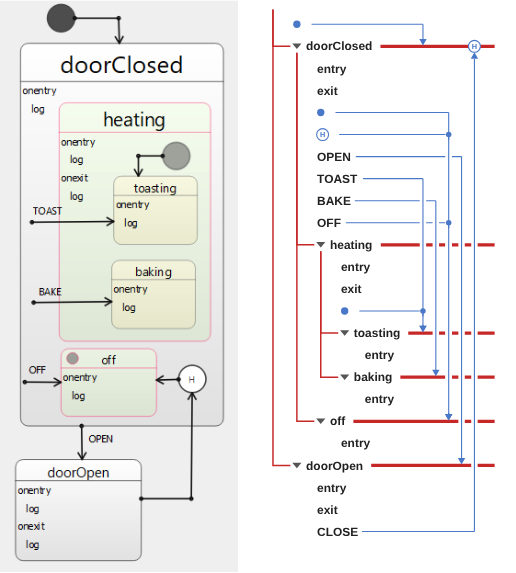

## Brought to you by:

# Linear Statechart Notation: State machine modeling for the AI era

Interactive demonstration of the Linear Statechart Notation, designed for **collaboration between humans and AI**. Instead of state boxes nested inside boxes, with transitions running willy-nilly between them, the notation draws a state machine as an outline, like a modern file explorer. The drawing is computed from a model that stores no geometry.

<i>The same state machine in the conventional notation (left) and in the Linear Statechart Notation (right). Click to open the demo.</i>

- **Try it:** https://www.state-machine.com/ai-statechart
- **Paper:** M. Samek, "State Machine Modeling for the AI Era: The Linear Statechart Notation", preprint, 2026. https://doi.org/10.5281/zenodo.24519410
- **Origin:** "Linear statechart notation", blog post, 2010. https://www.state-machine.com/linear-statechart-notation

# How it works

- A state is a row with its name and a horizontal line, its *rail*. Nesting is shown by indentation.
- Everything a state does is listed under its name: entry and exit actions, initial transition, history, and every transition it handles.
- Every transition leaves its row, runs up or down in a vertical lane, and ends with an arrowhead on the rail of its target state. Transitions to the same state share one lane, like wires in a schematic.
- Composite states fold and unfold like code blocks in an editor.
- The drawing is computed from the model by fixed rules, so it changes only where the model changes, and a model written or edited by an AI assistant can be drawn immediately.

# Using the demo

In the [demo](https://www.state-machine.com/ai-statechart) you can:

1. pick an example model (toaster, PELICAN or QHsmTst), or open any `.qmodel` file, such as the other models in `models/` or your own;
2. fold states, switch outline levels, and hover over or select states and transitions (the drawing and the XML highlight each other);
3. edit in the drawing (move states, transitions and choice segments up or down, delete them, rename, retarget arrows) or edit the XML text: the drawing follows every edit, and one Undo/Redo covers both.

The demo page has a **Quick guide** with all the details. On phones, the demo is read-only.

# What is here

| Path | Content |
|---|---|
| `index.html` | The demo: open it in a web browser (no build, no server needed). |
| `js/qmodel-xml.js` | Reader, canonical writer and checker of the QModel file format (plain JavaScript, also runs in Node). |
| `js/ops.js` | Editing operations in the drawing as minimal edits of the model text. |
| `schema/qmodel-1.xsd` | XML schema of the QModel file format. |
| `models/toaster.qmodel` | The toaster oven, the running example of the paper (Figs. 1, 3, 5). Default model of the demo. |
| `models/pelican.qmodel` | The PELICAN (PEdestrian LIght CONtrolled) crossing, with a nested choice (Figs. 4, 11). |
| `models/qhsmtst.qmodel` | QHsmTst, a contrived test model with every kind of transition and up to four levels of nesting. |
| `models/pelican-briefs.qmodel` | The PELICAN crossing with a brief (a leading `// comment`) on each action, as in Fig. 10. |
| `models/pelican-choice.qmodel` | An excerpt of the PELICAN crossing with only the state pedsFlash and its nested choice, as in Fig. 9. |
| `img/` | Images for this README and for link previews of the demo page. |

# Status

This is the first public version (November 2026): the reference implementation described in the [paper](https://doi.org/10.5281/zenodo.24519410). Coming next: a guided tour of the paper's figures, and support for trying the notation with your own AI assistant. Feedback is welcome (see below).

# Licensing
The code is [licensed](LICENSE) under the MIT open source license. The notation itself is disclosed as prior art in the paper and is free for anyone to use.

# Comments/Discussion
If you'd like to discuss the Linear Statechart Notation or this demo, please use the ["Issues" tab](https://github.com/QuantumLeaps/ai-statechart/issues).

# How to Help this Project?
Please feel free to clone, fork, and make pull requests to improve the demo.
If you like this project, please give it a star
(in the upper-right corner of your browser window):

